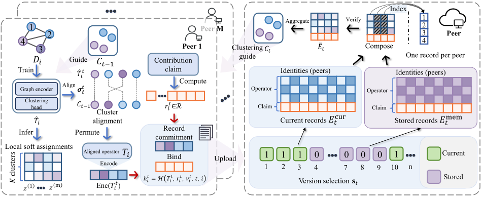

# Version Composition with Independent Auditing (VCIA)

VCIA selects a fixed-quota combination of current and stored peer records for decentralized federated graph-level clustering. It audits the selected aggregate on independent probes before admission, checking both soft-assignment drift and cluster reassignment probability.



## Quick start

Use Python 3.12 for the experiment environment tested with this release. The demo and unit tests run on CPU without data downloads.

```sh
git clone https://github.com/PinghanSun/VCIA.git
cd VCIA
python -m venv .venv
```

Activate the environment with `source .venv/bin/activate` on Linux/macOS or `.\.venv\Scripts\Activate.ps1` in PowerShell.

```sh
python -m pip install -c experiments/requirements.txt ".[test]"
python -m pcoc.demo
python -m pytest
```

For a browser walkthrough, download [admission_walkthrough.html](examples/admission_walkthrough.html?raw=1) and open it locally. It illustrates candidate screening, composition ranking, independent auditing, and retaining the stored state when the audit blocks a candidate. Regenerate it with `python -m pcoc.demo --html examples/admission_walkthrough.html`.

## Real-graph experiments

Download [PROTEINS](https://www.chrsmrrs.com/graphkerneldatasets/PROTEINS.zip), [ENZYMES](https://www.chrsmrrs.com/graphkerneldatasets/ENZYMES.zip), and [IMDB-BINARY](https://www.chrsmrrs.com/graphkerneldatasets/IMDB-BINARY.zip) from [TUDataset](https://chrsmrrs.github.io/datasets/docs/datasets/). Place the ZIP archives as downloaded in a `data/` directory at the repository root. The real-graph runners check the archive fingerprints. Use a new output directory for each execution.

### Check the execution paths

The following use only PROTEINS. They exercise the closed-loop learner and the fixed-snapshot replay, respectively, and write sealed outputs to the directories shown.

```sh
python experiments/run_evidence.py --smoke --data data --output runs/closed-loop-smoke
python experiments/run_checks.py --smoke --data data --output runs/replay-smoke
```

### Run the evaluation protocols

Run these commands in order. The 60-round closed-loop study uses PROTEINS and ENZYMES. The replay study also includes IMDB-BINARY and reads split and diagnostic inputs from the scored closed-loop study.

```sh
python experiments/run_evidence.py --data data --output runs/closed-loop
python experiments/score_evidence.py --data data --runs runs/closed-loop
python experiments/run_checks.py --data data --closed-loop runs/closed-loop --output runs/replay
python experiments/score_checks.py --data data --closed-loop runs/closed-loop --runs runs/replay
```

The [closed-loop protocol](experiments/evidence_protocol.json) records the split seeds, peer configurations, and probe budgets. The [replay protocol](experiments/replay_protocol.json) defines the matched snapshots and shared audit rules. The replay logs use the historical label `J-Rank` for the comparator whose ranking is restricted to the design-feasible family (J-Rank-Feasible in the paper). Scoring reads sealed predictions and writes CSV summaries in each run directory.

### Run the paired screening benchmark

Generate the two pilot run banks, then run and score the paired timing benchmark. The benchmark checks the executed state and graph-operator cache misses in each pair. It measures elapsed time on the executing machine within a single process.

```sh
python experiments/reference/run_pilot.py --dataset data/PROTEINS.zip --out runs/pilots/results_proteins_inner_v1
python experiments/reference/run_imdb_pilot.py --dataset data/IMDB-BINARY.zip --reference-manifest runs/pilots/results_proteins_inner_v1/manifest.json --out runs/pilots/results_imdb_binary_inner_v1
python experiments/run_core_gap.py timing --data data --pilot-runs runs/pilots --output runs/core-checks
python experiments/score_core_gap.py timing --runs runs/core-checks
```

### Extend the held-out split comparison

The additional split study derives eligible conditions from the scored closed-loop run and writes paired NMI and ARI summaries.

```sh
python experiments/run_core_gap.py plan --closed-loop runs/closed-loop --output runs/core-checks
python experiments/run_core_gap.py extend --outer 31504 --data data --output runs/core-checks
python experiments/run_core_gap.py extend --outer 31505 --data data --output runs/core-checks
python experiments/run_core_gap.py extend --outer 31506 --data data --output runs/core-checks
python experiments/score_core_gap.py quality --data data --closed-loop runs/closed-loop --runs runs/core-checks
```

## Generated stress tests

The generated-response experiments cover accuracy trajectories, recovery, and parameter sensitivity. They use seeded synthetic probabilities and require no graph data. See the [experiment notes](legacy/README.md) for the design and output schema.

```sh
python -m legacy main20 --output runs/numerical20
python -m legacy supplement20 --main runs/numerical20 --output runs/numerical-supplement
python -m legacy followup60 --main runs/numerical20 --output runs/numerical60
```

## Paper figures

[Motivation](figures/motivation.pdf) · [VCIA workflow](figures/workflow.pdf) · [Stress-test trajectories and recovery](figures/stress-test.pdf) · [Sensitivity](figures/sensitivity.pdf)

## Citation

Use [CITATION.cff](CITATION.cff) to cite the code artifact.
